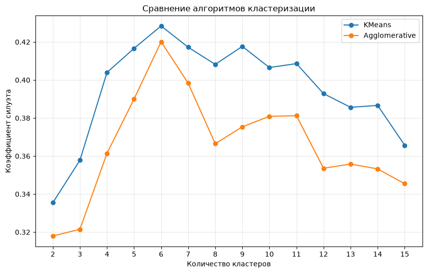
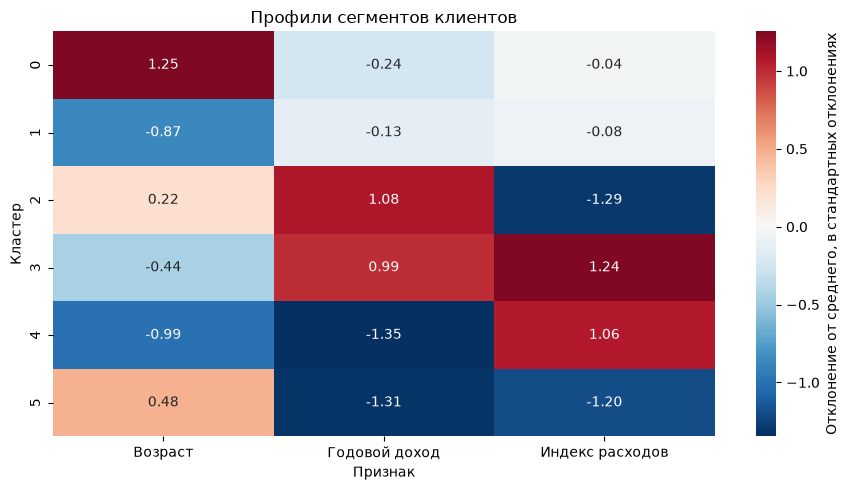

# Сегментация клиентов торгового центра

Выделение групп покупателей по возрасту, доходу и индексу расходов. Сравниваются KMeans, агломеративная кластеризация и KMeans после PCA. Итог — шесть сегментов с различимыми профилями; лучший коэффициент силуэта составляет 0,428.

## Задача и данные

Сегментация должна помочь сформулировать гипотезы для персональных предложений. В исходном учебном наборе 205 клиентов и пять столбцов. После замены ошибочного индекса расходов 120 на пропуск и удаления пяти строк с пропусками осталось 200 клиентов. Полных дубликатов нет. Два значения дохода 137 тыс. долларов выходят за границу IQR, но сохранены как правдоподобные.

В расчёте расстояний участвуют `age`, `annual_income` и `spending_score`. Идентификатор исключён из признаков модели, пол используется только для описания групп. Источник и размещение CSV описаны в [data/README.md](data/README.md).

## Подход

- Анализ распределений, попарных связей и интерактивного 3D-графика.
- Стандартизация трёх числовых признаков с `StandardScaler`.
- Перебор 2–15 кластеров для KMeans с k-means++, `n_init=10`, `random_state=42` и агломеративной кластеризации с методом Уорда.
- Понижение размерности с PCA до двух компонент и повторный подбор числа кластеров KMeans.
- Описание выбранных групп по размерам, средним, медианам и наиболее частому значению пола.

## Результаты

| Подход | Лучшее число кластеров | Коэффициент силуэта |
| --- | ---: | ---: |
| **KMeans на трёх стандартизированных признаках** | **6** | **0,428** |
| Агломеративная кластеризация, Ward | 6 | 0,420 |
| PCA → KMeans | 2 | 0,426 |

Две компоненты PCA сохранили 77,6% дисперсии. Максимальный силуэт после PCA не вырос. При этом расстояния до и после PCA относятся к разным пространствам: разницу метрик нельзя трактовать как доказательство превосходства сегментов для бизнеса. Для итоговой интерпретации выбран KMeans без PCA.



## Профили клиентов

Средние значения признаков для выбранных шести кластеров:

| Кластер | Клиентов | Возраст, лет | Доход, тыс. $ в год | Индекс расходов | Профиль |
| --- | ---: | ---: | ---: | ---: | --- |
| 0 | 45 | 56,3 | 54,3 | 49,1 | Старшая группа со средней активностью |
| 1 | 39 | 26,8 | 57,1 | 48,1 | Молодые клиенты со средней активностью |
| 2 | 33 | 41,9 | 88,9 | 17,0 | Высокий доход, низкая активность |
| 3 | 39 | 32,7 | 86,5 | 82,1 | Высокий доход, высокая активность |
| 4 | 23 | 25,0 | 25,3 | 77,6 | Низкий доход, высокая активность |
| 5 | 21 | 45,5 | 26,3 | 19,4 | Низкий доход, низкая активность |

Группы 0 и 1 близки по доходу и активности, но различаются возрастом. Группы 2 и 3 при сходном высоком доходе имеют противоположные значения индекса расходов; похожее различие наблюдается между группами 4 и 5 с низким доходом.



Для группы 2 можно проверить персональные предложения для повышения активности, для группы 3 — программы удержания, для группы 4 — доступные акции. Это гипотезы для последующих экспериментов. Эффект кампаний и прибыльность сегментов в работе не измерялись.

## Воспроизведение

Python 3.13. Из папки проекта:

```bash
python -m venv .venv
source .venv/bin/activate
pip install -r requirements.txt
jupyter notebook analysis.ipynb
```

Поместите исходный CSV в `data/customers.csv`, перезапустите ядро и выполните ячейки по порядку. В Google Colab загрузите CSV в папку `/content/data`; результаты сохраняются в ноутбуке. Для просмотра интерактивного графика в VS Code используйте расширение Jupyter и средство отображения Plotly/Jupyter Notebook Renderers.

## Границы результата

Проект основан на учебной работе и одном небольшом наборе данных. Происхождение и условия распространения этой версии CSV не подтверждены. Все клиенты использованы для построения и сравнения кластеров; устойчивость сегментов на новых данных и при изменении выборки не проверялась. Число кластеров выбрано по максимуму силуэта при фиксированных настройках, а не по измеренному бизнес-эффекту.

Индекс расходов — условная оценка активности. Он не позволяет напрямую определить реальные суммы покупок, частоту визитов, прибыльность или давность последней покупки. Из этих данных нельзя установить, что клиент «ушёл» или нуждается в реактивации. Номера кластеров условны и не задают рейтинг клиентов.
