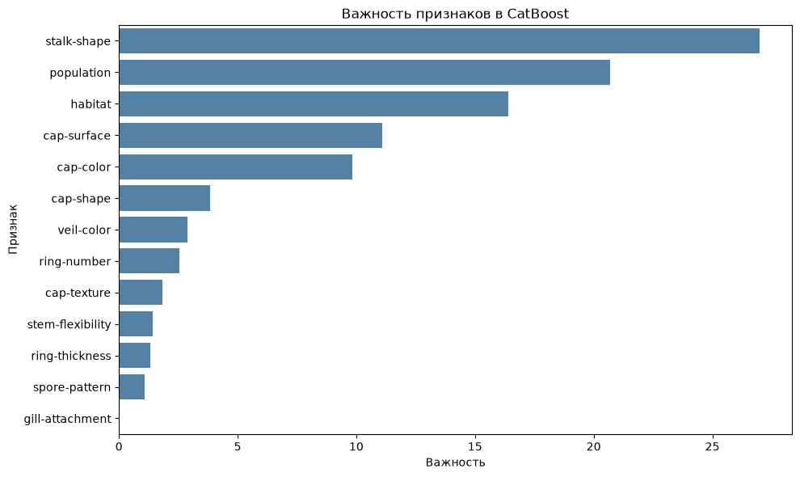

# Классификация ядовитых грибов

Исследование категориальных данных: сравнение Gradient Boosting и CatBoost, кросс-валидация и подбор порога для повышения Recall ядовитого класса.

## Задача и данные

Определить класс гриба по признакам внешнего вида и среды обитания. В наборе 8 124 объекта и 14 исходных признаков. Один константный признак удалён; скрытый пропуск `?` заменён отдельной категорией `missing`. Соотношение классов — примерно 52/48.

## Подход

- Стратифицированное разбиение 80/10/10, `random_state=42`.
- One-Hot Encoding для классического бустинга: 91 выходной столбец. При CV кодировщик обучается внутри Pipeline на тренировочной части каждого фолда.
- CatBoost получает исходные категориальные признаки.
- Базовый sklearn-бустинг, затем пятифолдовый GridSearchCV по Recall для обеих семейств моделей.
- Сравнение порогов 0,50 / 0,40 / 0,30 / 0,20 на validation и анализ важности признаков.

## Результаты

Показатели при пороге 0,5 на test (813 объектов):

| Модель | Recall ядовитых | Precision ядовитых | Accuracy | Пропущено ядовитых |
| --- | ---: | ---: | ---: | ---: |
| Базовый Gradient Boosting | 0,911 | 0,939 | 0,929 | 35 / 392 |
| Gradient Boosting после подбора | 0,913 | 0,975 | 0,947 | 34 / 392 |
| CatBoost с ранней остановкой | 0,918 | 0,981 | 0,952 | 32 / 392 |

У CatBoost с ранней остановкой снижение порога с 0,5 до 0,2 на validation увеличило Recall с 0,931 до 1,000. Число пропущенных ядовитых грибов сократилось с 27 до 0, а съедобных грибов, ошибочно признанных ядовитыми, выросло с 4 до 50. Порог 0,2 на test не проверялся.

Наибольшую важность в этой модели получили форма ножки (`stalk-shape`), тип популяции (`population`) и среда обитания (`habitat`).



## Воспроизведение

Python 3.13. Из папки этого проекта:

```bash
python -m venv .venv
source .venv/bin/activate
pip install -r requirements.txt
jupyter notebook analysis.ipynb
```

Поместите исходный CSV в `data/mushrooms.csv` и выполняйте ячейки по порядку. Данные и их происхождение описаны в [data/README.md](data/README.md). Ноутбук содержит сохранённые результаты полного последовательного прогона. Дополнительная CV CatBoost выполняет 20 обучений по 5000 итераций и финальное переобучение; на CPU это может занять несколько минут.

## Границы результата

Это исследовательский кейс на одном наборе данных, без проверки в эксплуатации. Validation использована для ранней остановки, сравнения вариантов и порогов; test уже просмотрен при сравнении моделей. Для подтверждения качества выбранного решения нужны новые данные. Сто процентов Recall на 391 ядовитом грибе validation не гарантируют отсутствия ошибок на других объектах. Модель не предназначена для определения безопасности употребления реальных грибов. Важность признаков описывает модель и не доказывает причинность.
